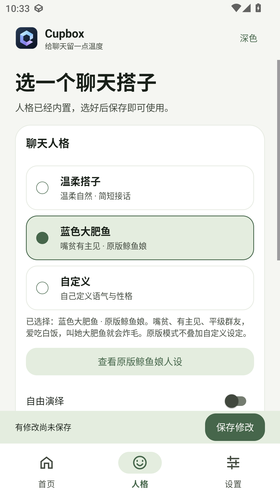

# 验证记录 · 0.2.0

日期：2026-10-25（北京时间）。本次更新仅在本地完成，未推送 GitHub。0.1.0 的历史验证见 [VALIDATION-0.1.0.md](VALIDATION-0.1.0.md)。

## 构建与常规测试

| 检查 | 结果 |
| --- | --- |
| 签名发布构建 | `assembleRelease` 成功，R8 和资源压缩开启 |
| JVM 核心测试 | 10 项，0 失败 |
| 静态检查 | `lintDebug` 与 Release vital lint 通过，无错误 |
| Android 12 常规设备测试 | 5 项，0 失败 |
| APK 签名 | `apksigner verify --verbose` 通过，v2 签名 |
| 发布包安装与启动 | 安装成功，一次冷启动 TotalTime 280 ms；非统计性能基准 |
| 发布包界面 | 独立 adb/UI 层级脚本遍历五页和深浅主题通过，已查看竖屏截图 |

APK：`release/Cupbox-Android-Qbot-0.2.0-release.apk`，3,857,379 字节，约 3.68 MiB。SHA-256：

```text
33bbbd8ea9b57f955e668ae4b5bc59e38524084f17b2cec0b2b0eace4b79ab8c
```

核心测试新增鲸鱼娘原版 / 自由演绎隔离、人格配置持久化与表情标记清理；原有白名单、伪造 @、黑名单、私聊、账号隔离、HTTP 请求格式、错误和响应体上限测试继续通过。

5 项常规设备测试包括：Keystore 与记忆上限、模拟 OneBot → 模型 → QQ 投递回执、原生 PRoot 执行、五页 Material 3 / 深浅主题 / 大肥鱼选择、登录页竖屏。主界面和登录页都断言 Manifest 的请求方向为 portrait，主界面同时核对实际资源方向为竖屏。设备分辨率为 1080×1920、420 dpi。

## 本机登录验收

在专用 Android 12 / API 31 x86_64 模拟器上显式启用 `LocalLoginDeviceTest`，实际完成：

1. 准备并校验 Ubuntu 24.04 用户态根文件系统。
2. 下载、校验并安装 Linux QQ 3.2.34-53644、NapCat v4.18.41 及启动器，安装 Ubuntu 依赖并编译启动器。
3. 在 Android 应用 UID 下实际执行 PRoot，启动 Xvfb、Linux QQ 与 NapCat。
4. 完成 NapCat WebUI 认证与登录状态查询，得到真实 QQ 登录二维码。二维码在 Android 端使用 ZXing 生成。
5. 复用已安装环境，再次取得二维码。
6. 停止本机 QQ，按应用 UID 检查没有遗留的 `proot`、`qq`、`Xvfb` 子进程，再次启动并重新取得二维码。

首轮完整初始化约 236.6 秒；一次已安装环境启动验收约 5.4 秒。修复进程清理后，“启动取码 → 停止清理 → 重新启动取码”验收通过，约 15.2 秒。以上为单次模拟器样本，受网络和缓存影响，不承诺真机耗时。

此前停止测试发现原先仅终止父进程可能留下子进程；已改为独立 session / 进程组，先 TERM、再限时 KILL，清理与重启测试通过。

正式发布 APK 也已通过实际界面从零完成首次初始化并显示真实二维码；随后通过界面停止本机 QQ，宿主进程检查确认没有残留 proot、qq 或 Xvfb。测试没有扫描二维码、没有登录真实 QQ 账号，也没有调用付费模型或向真实 QQ 发送消息。

## 限制

- 尚未实测 ARM64 手机、骁龙 480、Android 13–15 及不同厂商的后台策略。
- 真实账号扫码确认、设备验证、群聊 / 私聊收发、风控和长时间运行需账号本人核对。
- 大肥鱼迁入的是原版人设、来源与自由演绎逻辑；当前没有图片识别、表情图库和桌面插件。
- 本机 QQ 显著增加磁盘、内存和电量使用，不能沿用 0.1.0 远程客户端的 228 KiB 体积或内存结论。

## 界面

以下前两张为正式发布 APK；大肥鱼页面为同版代码的设备界面测试截图。登录二维码包含临时登录信息，不放入项目公开预览。

| 浅色概览 | 深色概览 | 蓝色大肥鱼 |
| --- | --- | --- |
|  |  |  |

| 本机连接 | 规则 | 记忆 |
| --- | --- | --- |
|  |  |  |
