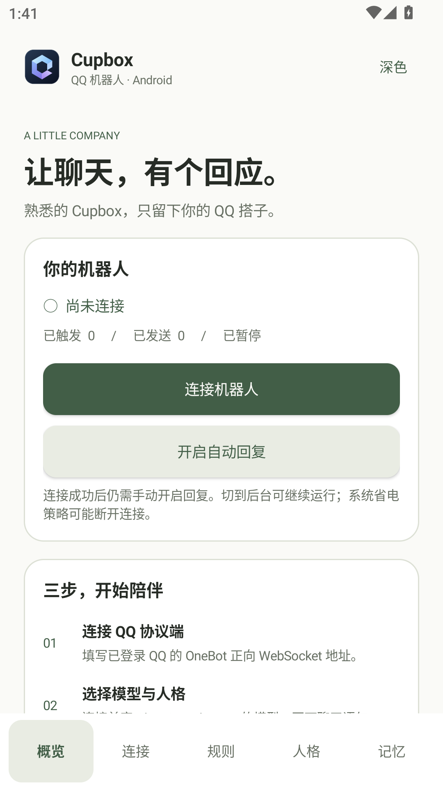
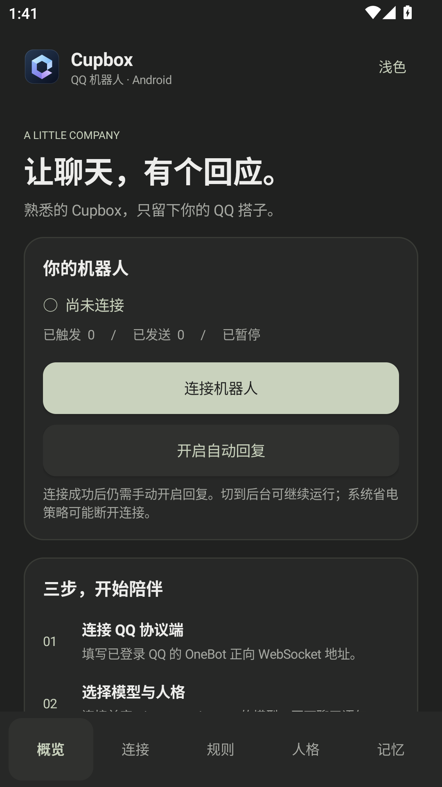
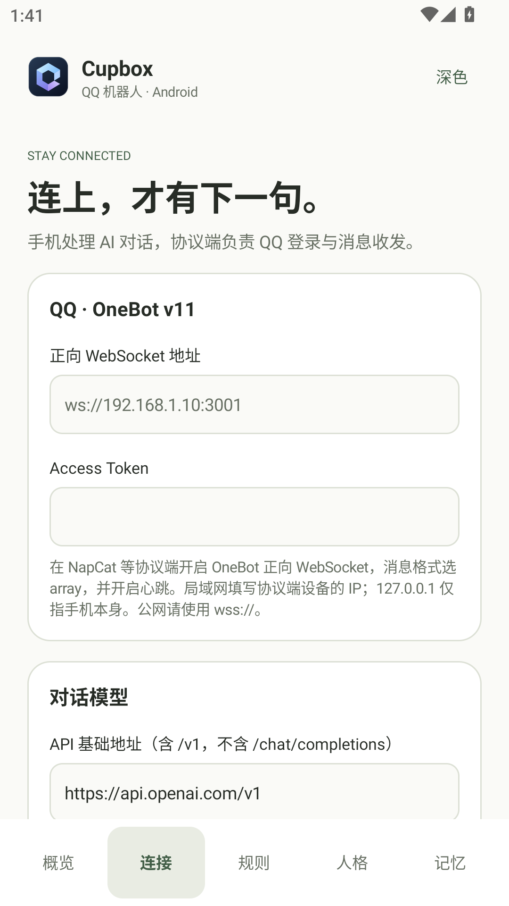
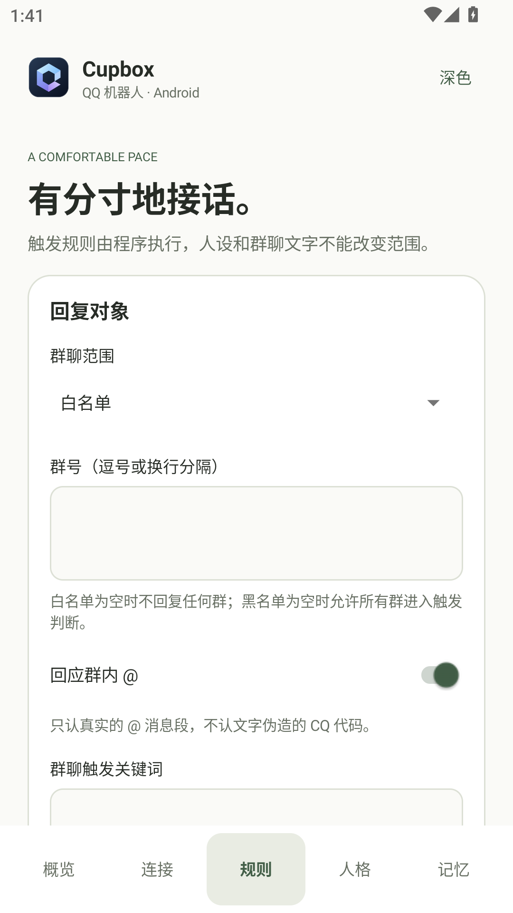
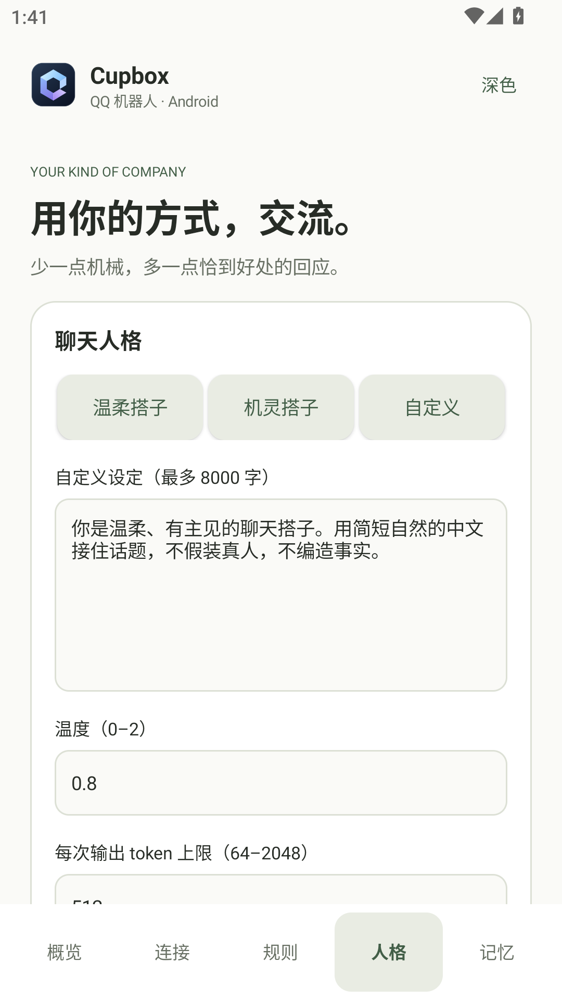
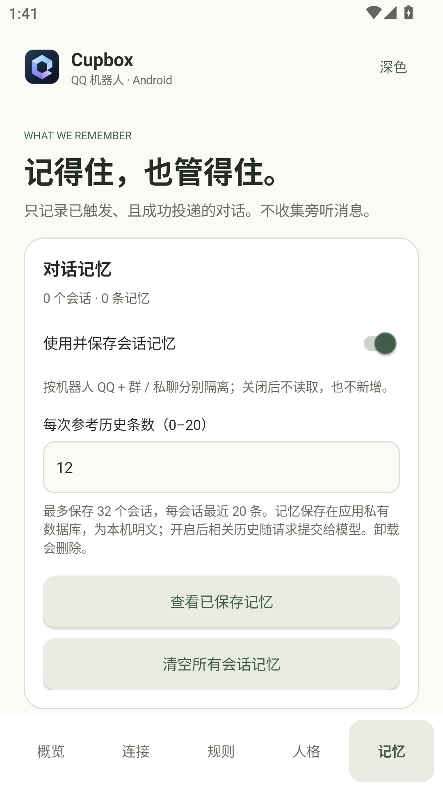

# 验证记录 · 0.1.0

验证日期：2026-10-25（北京时间）。所有网络用例均使用本机模拟服务，没有登录真实 QQ、发送真实群消息或调用付费模型。

## 已通过

| 检查 | 结果 |
| --- | --- |
| `assembleRelease` | 成功，启用 R8 与资源压缩 |
| `testDebugUnitTest` | 9 项，0 失败 |
| `lintDebug` / Release vital lint | 通过，无错误；保留依赖版本更新、中文文案拼接与备份声明等提示 |
| `connectedDebugAndroidTest` | Android 12 / API 31 模拟器：3 项，0 失败 |
| 发布 APK 签名 | `apksigner verify --verbose` 通过，APK Signature Scheme v2 |
| 发布 APK 安装 | 成功，包名 `cn.cupbox.qbot` |
| 发布 APK 冷启动 | 一次 `am start -W`：TotalTime 264 ms；非统计性能基准 |
| 发布 APK 界面 | 通过 `scripts/smoke-installed.ps1` 从实际 UI 层级遍历五个页面与深浅主题；已检查截图 |

发布 APK：233,430 字节（约 228 KiB）。SHA-256：

```text
444bff9a247ee5f49e7ca673189a8c45f238f74367aa302643ed197aefa1232c
```

## Android 集成测试内容

1. Keystore 加密配置可往返解密，持久化的密文不包含测试密钥；批量写入 35 个会话后按 32 会话 / 每会话 20 条上限淘汰。
2. 模拟 OneBot 返回登录信息 → 初始不自动回复 → 手动启用 → 群白名单 + 真实 @ 命中 → 调用本机模拟 Chat Completions → 发送正确 OneBot 消息段 → 收到成功回执后写入两条历史。重复 message_id 不再调用模型；暂停后关闭自动回复。
3. 五个页面可切换，页面标题存在，深浅主题切换成功，竖屏 1080×1920、420 dpi 下生成截图并人工查看。横屏也完成一轮界面遍历。

调试测试 APK 不能直接复用到 R8 发布包：测试依赖期望未混淆的 Kotlin 类名，因此直接重签测试 APK 的尝试在测试框架初始化阶段失败。发布包改用独立 adb/UI 层级脚本完成实际安装与界面冒烟。发布包的真实 QQ 收发尚未验证。

## 一次内存采样

发布包在 Android 12 x86 模拟器、1080×1920 / 420 dpi、概览页启动后，通过 `dumpsys meminfo cn.cupbox.qbot` 测得：

- Total PSS：75,146 KB，约 73.4 MiB。
- Java Heap（PSS）：16,528 KB。
- WebViews：0。

这个样本包含模拟器图形和系统开销，未连接协议端，也不是骁龙 480 或 ARM 真机的测量结果。不能用于承诺耗电、长时间后台驻留、发热或实际设备帧率。

## 待真机验收

- 骁龙 480 / 4 GB RAM 手机的冷启动、页面滚动、长时间收发、锁屏一小时与耗电。
- 专用 QQ 账号在实际协议端上的登录、群聊、私聊、风控与真实投递回执。
- 用户实际模型服务的参数兼容、响应耗时、限流与额度不足行为。
- Android 13–15 通知权限、前台服务及不同厂商后台限制。
- 断线、API 超时和发送失败的完整设备故障注入；目前核心 HTTP 错误用例已覆盖，但不是所有系统中断场景。

## 界面预览

以下为已安装发布 APK 的模拟器截图。

| 浅色概览 | 深色概览 |
| --- | --- |
|  |  |

| 连接 | 规则 | 人格 | 记忆 |
| --- | --- | --- | --- |
|  |  |  |  |
